<p align="center">
  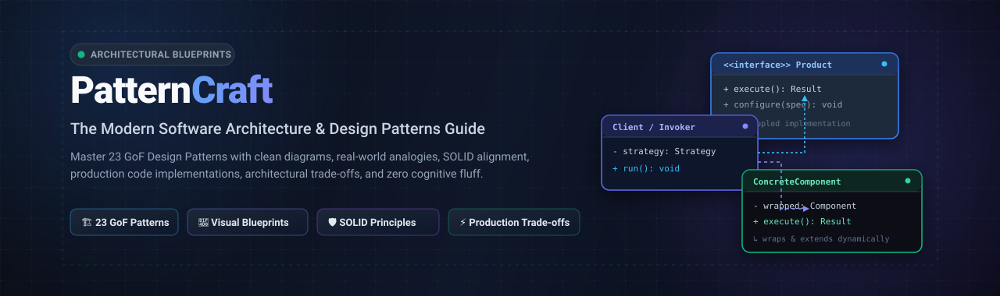
</p>

<p align="center">
  <strong>The Definitive Visual, Practical &amp; Architectural Guide to Software Design Patterns</strong>
</p>

<p align="center">
  <a href="https://github.com/Rahulchaube1/PatternCraft/stargazers"></a>
  <a href="https://github.com/Rahulchaube1/PatternCraft/network/members"></a>
  <a href="./LICENSE"></a>
  <a href="./CONTRIBUTING.md"></a>
  <a href="https://buymeacoffee.com/rahulchaube"></a>
  <a href="https://rahulchaube1.com"></a>
</p>

<p align="center">
  <a href="#-creational-design-patterns"></a>
  <a href="#-structural-design-patterns"></a>
  <a href="#-behavioral-design-patterns"></a>
  <a href="#-solid-principles-alignment"></a>
  <a href="#-architectural-selection-flowchart"></a>
</p>

---

## 📖 Executive Overview

**Software Design Patterns** are time-tested, reusable architectural blueprints for solving recurring challenges in software design. They do not represent libraries or plug-and-play code snippets; rather, they provide structured mental models and object compositions that transform brittle, tightly coupled codebases into extensible, maintainable, and resilient software systems.

This repository provides an ultra-clear, real-world, and battle-tested guide to all **23 Gang of Four (GoF) patterns** plus foundational idioms. Every pattern is dissected with:
1. **The Real-World Intuition**: Plain-English analogies from everyday life (zero academic jargon).
2. **The Problem & Anti-Pattern**: Why naive approaches fail as systems grow.
3. **Clean Architecture & UML Diagrams**: High-clarity native vector schematics and sequence flows.
4. **Strongly-Typed Production Code**: Modern, clean, executable implementations with clear contracts.
5. **Architectural Trade-Offs**: When to use, when **NOT** to use, and memory/complexity costs.
6. **Industry Precedents**: Real-world sightings in Linux, Spring, Kubernetes, React, Node.js, and Java SDK.

---

<p align="center">
  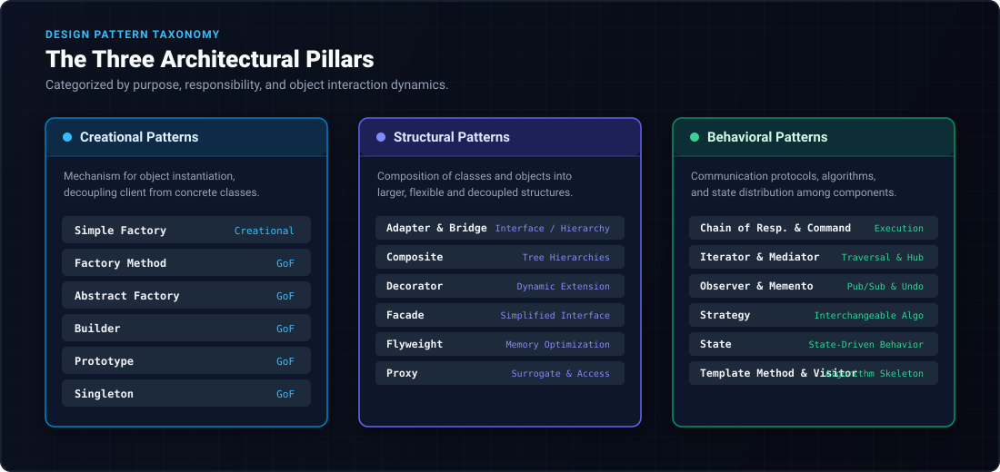
</p>

---

## 📑 Fast Navigation Matrix

| 🏗️ [Creational Patterns](#-creational-design-patterns) | 🧩 [Structural Patterns](#-structural-design-patterns) | ⚡ [Behavioral Patterns](#-behavioral-design-patterns) |
| :--- | :--- | :--- |
| • [Simple Factory](#1-simple-factory) | • [Adapter](#7-adapter) | • [Chain of Responsibility](#14-chain-of-responsibility) |
| • [Factory Method](#2-factory-method) | • [Bridge](#8-bridge) | • [Command](#15-command) |
| • [Abstract Factory](#3-abstract-factory) | • [Composite](#9-composite) | • [Iterator](#16-iterator) |
| • [Builder](#4-builder) | • [Decorator](#10-decorator) | • [Mediator](#17-mediator) |
| • [Prototype](#5-prototype) | • [Facade](#11-facade) | • [Memento](#18-memento) |
| • [Singleton](#6-singleton) | • [Flyweight](#12-flyweight) | • [Observer](#19-observer) |
| | • [Proxy](#13-proxy) | • [Visitor](#20-visitor) |
| | | • [Strategy](#21-strategy) |
| | | • [State](#22-state) |
| | | • [Template Method](#23-template-method) |

---

## 🧭 Architectural Selection Flowchart

Before writing code, use this decision framework to match your engineering constraint with the right pattern:

<p align="center">
  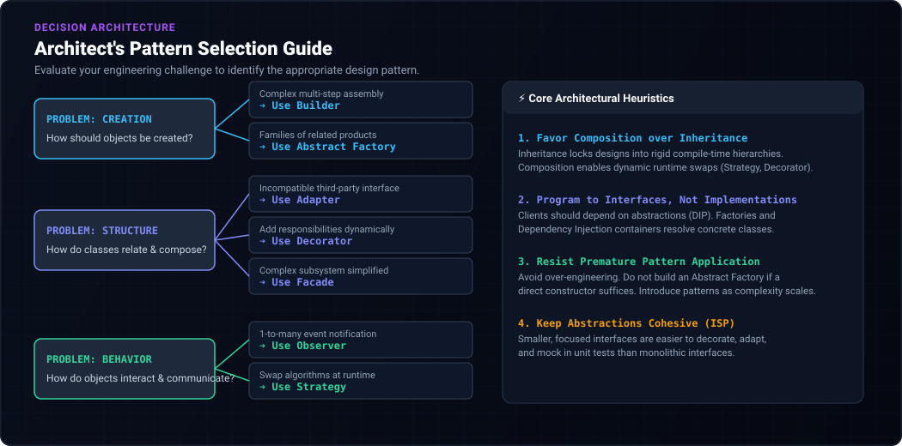
</p>

---

## 📐 SOLID Principles Alignment

Design patterns are not arbitrary rules; they are the concrete realization of **SOLID** principles:

| Principle | Description | Primary Manifesting Patterns |
| :--- | :--- | :--- |
| **S** – Single Responsibility | A class should have only one reason to change. | **Command, Facade, Strategy, Observer** |
| **O** – Open / Closed | Open for extension, closed for modification. | **Decorator, Strategy, Factory Method, Template Method** |
| **L** – Liskov Substitution | Subtypes must be substitutable for base types. | **Composite, Adapter, Abstract Factory** |
| **I** – Interface Segregation | Prefer small, client-specific interfaces over fat ones. | **Adapter, Bridge, Visitor** |
| **D** – Dependency Inversion | Depend on abstractions, never on concrete classes. | **Abstract Factory, Factory Method, Strategy** |

---

# 🏗️ Creational Design Patterns

> Creational patterns abstract the object instantiation process. They decouple the client application from the concrete mechanisms of how objects are constructed, assembled, and represented.

<p align="center">
  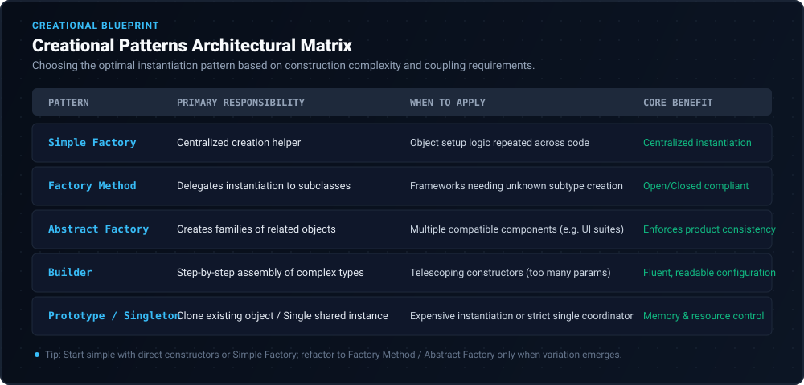
</p>

---

### 1. Simple Factory

> **Intent:** Centralizes object creation into a dedicated utility, shielding client code from direct class instantiations.

#### 🌍 Real-World Analogy
Consider ordering a custom mahogany door for your home. You do not purchase timber, saws, nails, and varnish to hand-carve the door inside your living room. You simply call a Door Workshop, specify the dimensions and wood finish, and receive a fully assembled door ready for installation.

#### 🎯 Problem & Motivation
When client code repeatedly instantiates concrete classes (`new WoodenDoor()`, `new SteelDoor()`) scattered across multiple controllers, changing the constructor parameters or adding initialization logic forces edits across dozens of files.

#### 📐 Architecture & Diagram

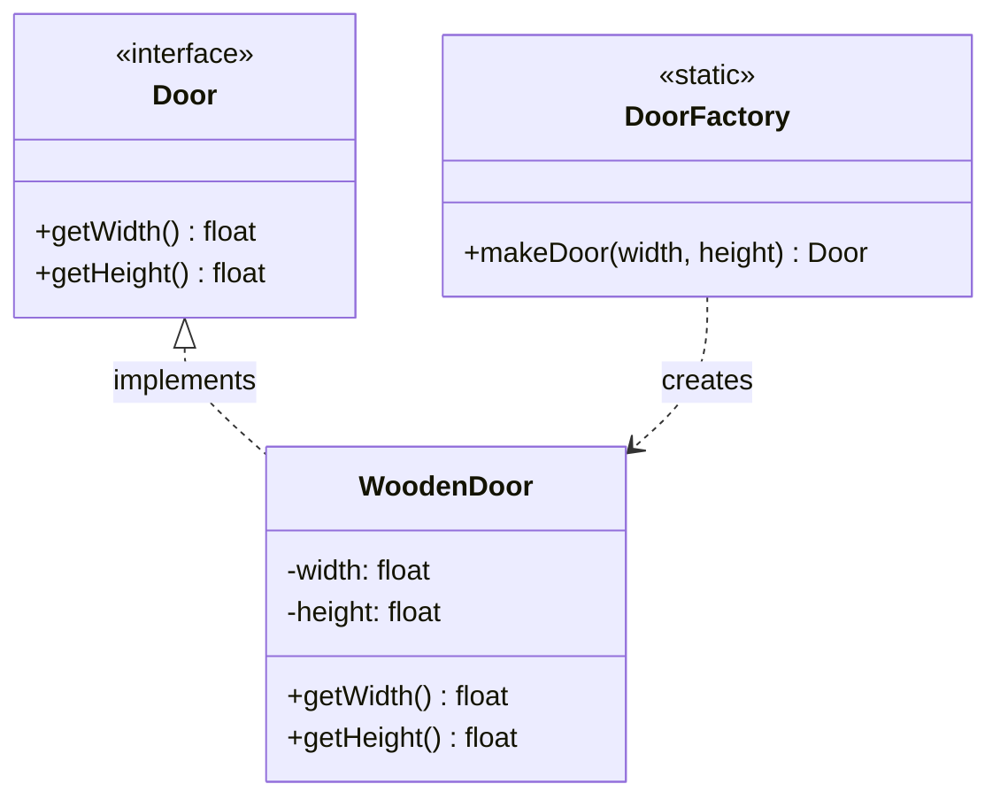

#### 💻 Production-Grade Code

```php
<?php

declare(strict_types=1);

interface Door
{
    public function getWidth(): float;
    public function getHeight(): float;
}

final class WoodenDoor implements Door
{
    public function __construct(
        private readonly float $width,
        private readonly float $height
    ) {}

    public function getWidth(): float
    {
        return $this->width;
    }

    public function getHeight(): float
    {
        return $this->height;
    }
}

final class DoorFactory
{
    public static function makeDoor(float $width, float $height): Door
    {
        // Centralized validation, logging, or pre-configuration
        if ($width <= 0 || $height <= 0) {
            throw new InvalidArgumentException("Door dimensions must be positive values.");
        }

        return new WoodenDoor($width, $height);
    }
}

// Client Execution
$door = DoorFactory::makeDoor(120.0, 220.0);
echo sprintf("Manufactured Door: %.1fm x %.1fm\n", $door->getWidth(), $door->getHeight());
```

#### ⚖️ Trade-offs & Analysis
* **Advantages:** Shields client code from direct dependencies; centralizes validation and instantiation rules.
* **Disadvantages:** Adding new types violates the Open/Closed Principle if the factory method relies on internal `switch/case` logic.
* **Industry Precedent:** `Calendar.getInstance()` in Java; `DriverManager.getConnection()` in JDBC; `LoggerFactory.getLogger()` in SLF4J.

---

### 2. Factory Method

> **Intent:** Defines an interface for creating an object, but delegates the actual instantiation decision to derived subclasses.

#### 🌍 Real-World Analogy
A hiring corporation has different departmental divisions. An Engineering Manager knows they must hire a candidate who can conduct technical evaluations, while a Marketing Manager hires someone skilled in market campaigns. The overarching hiring workflow is identical across the organization, but each department manager instantiates the specific professional role they require.

#### 🎯 Problem & Motivation
A high-level framework class needs to orchestrate a business flow, but it cannot anticipate the exact concrete types that will be required until runtime or client-level specialization.

#### 📐 Architecture & Diagram

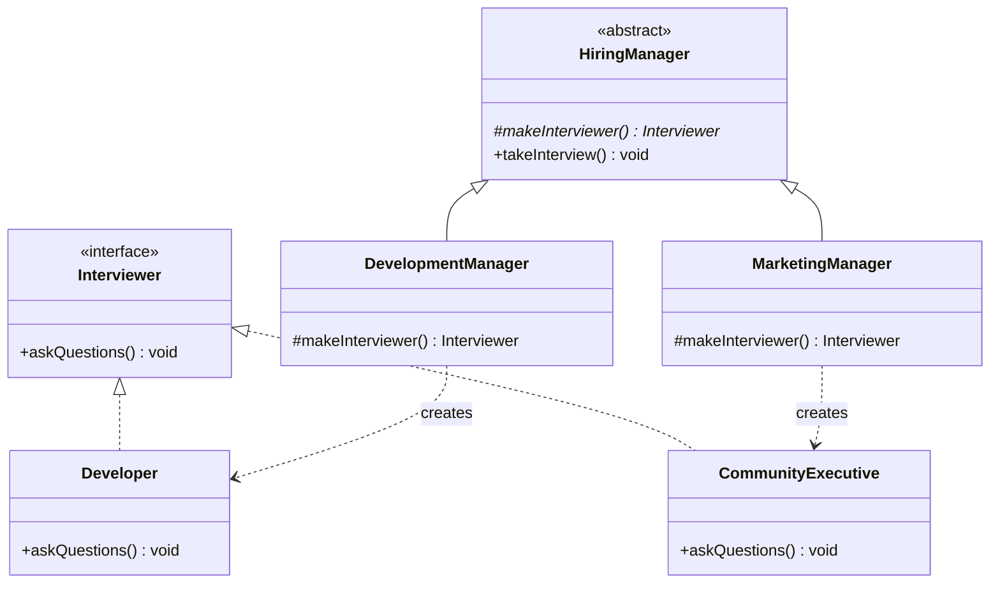

#### 💻 Production-Grade Code

```php
<?php

declare(strict_types=1);

interface Interviewer
{
    public function askQuestions(): string;
}

final class Developer implements Interviewer
{
    public function askQuestions(): string
    {
        return "Asking about systems architecture, concurrency, and algorithms.";
    }
}

final class CommunityExecutive implements Interviewer
{
    public function askQuestions(): string
    {
        return "Asking about developer community engagement and brand growth.";
    }
}

abstract class HiringManager
{
    // The Factory Method
    abstract protected function makeInterviewer(): Interviewer;

    public function takeInterview(): void
    {
        $interviewer = $this->makeInterviewer();
        echo $interviewer->askQuestions() . PHP_EOL;
    }
}

final class DevelopmentManager extends HiringManager
{
    protected function makeInterviewer(): Interviewer
    {
        return new Developer();
    }
}

final class MarketingManager extends HiringManager
{
    protected function makeInterviewer(): Interviewer
    {
        return new CommunityExecutive();
    }
}

// Client Execution
$devManager = new DevelopmentManager();
$devManager->takeInterview(); // Output: Asking about systems architecture...

$marketingManager = new MarketingManager();
$marketingManager->takeInterview(); // Output: Asking about developer community...
```

#### ⚖️ Trade-offs & Analysis
* **Advantages:** Adheres to the Open/Closed Principle; decouples high-level business orchestrators from concrete classes.
* **Disadvantages:** Forces client code to introduce an extra subclass hierarchy just to construct a specific product variant.
* **Industry Precedent:** `Document.createRenderer()` in GUI engines; `java.util.Collection.iterator()`; Spring Framework `FactoryBean`.

---

### 3. Abstract Factory

> **Intent:** Provides an interface for creating families of related or dependent objects without specifying their concrete classes.

#### 🌍 Real-World Analogy
Consider furnishing a house. If you select a Victorian styling, you need a Victorian Door along with a Carpenter specialist who understands Victorian carvings. If you select an Industrial Iron styling, you need an Iron Door paired with a Master Welder. Mixing an Iron door with a wooden molding carpenter creates architectural dissonance. An Abstract Factory guarantees that all instantiated products belong to the exact same harmonious family.

#### 🎯 Problem & Motivation
Your system must create suites of related components (e.g. cross-platform GUI buttons, windows, and scrollbars for macOS vs Windows vs Linux). Directly instantiating mixed classes creates visual bugs and incompatible runtime crashes.

#### 📐 Architecture & Diagram

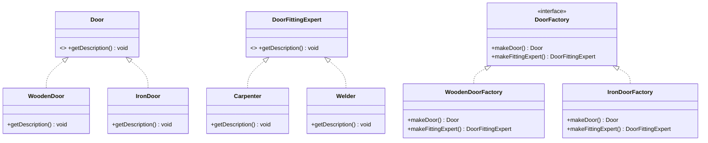

#### 💻 Production-Grade Code

```php
<?php

declare(strict_types=1);

interface Door
{
    public function getDescription(): string;
}

final class WoodenDoor implements Door
{
    public function getDescription(): string
    {
        return "Heavy Oak Wood Door";
    }
}

final class IronDoor implements Door
{
    public function getDescription(): string
    {
        return "Reinforced Galvanized Iron Door";
    }
}

interface DoorFittingExpert
{
    public function getDescription(): string;
}

final class Carpenter implements DoorFittingExpert
{
    public function getDescription(): string
    {
        return "Master Carpenter specialized in wood joinery";
    }
}

final class Welder implements DoorFittingExpert
{
    public function getDescription(): string
    {
        return "Certified Structural Welder";
    }
}

interface DoorFactory
{
    public function makeDoor(): Door;
    public function makeFittingExpert(): DoorFittingExpert;
}

final class WoodenDoorFactory implements DoorFactory
{
    public function makeDoor(): Door
    {
        return new WoodenDoor();
    }

    public function makeFittingExpert(): DoorFittingExpert
    {
        return new Carpenter();
    }
}

final class IronDoorFactory implements DoorFactory
{
    public function makeDoor(): Door
    {
        return new IronDoor();
    }

    public function makeFittingExpert(): DoorFittingExpert
    {
        return new Welder();
    }
}

// Client Execution
function assemblePortal(DoorFactory $factory): void
{
    $door = $factory->makeDoor();
    $expert = $factory->makeFittingExpert();

    echo sprintf("Portal Installed: %s with expert %s\n", $door->getDescription(), $expert->getDescription());
}

assemblePortal(new WoodenDoorFactory());
assemblePortal(new IronDoorFactory());
```

#### ⚖️ Trade-offs & Analysis
* **Advantages:** Guarantees absolute consistency between family products; enforces the Single Responsibility and Open/Closed principles.
* **Disadvantages:** Introducing a brand new product type (e.g. `makeDoorAlarm()`) requires mutating the base `DoorFactory` interface and all implementations.
* **Industry Precedent:** Cross-platform GUI toolkits (Qt, Java AWT); database abstraction drivers (e.g. Connection, Command, DataAdapter in ADO.NET).

---

### 4. Builder

> **Intent:** Separates the construction of a complex object from its representation, allowing the same construction process to create diverse representations.

#### 🌍 Real-World Analogy
Consider ordering a custom gourmet burger at a fast-food counter. The cashier does not hand you a single monolithic form requiring 15 checkboxes at once. Instead, you incrementally select your patty size, cheese variety, extra bacon, caramelized onions, and gourmet sauces. The builder manages your selections and serves a custom-crafted burger upon calling `build()`.

#### 🎯 Problem & Motivation
**The Telescoping Constructor Anti-Pattern:** A constructor requiring 8+ parameters where most are optional booleans or nullables: `new Burger(14, true, false, true, false, true, null, true)`. Reading this code is error-prone, brittle, and impossible to maintain.

#### 📐 Architecture & Diagram

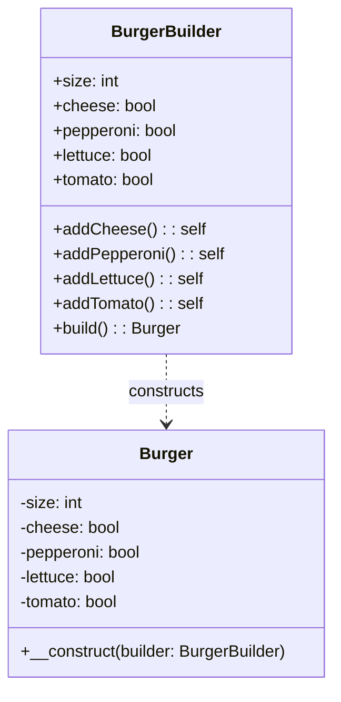

#### 💻 Production-Grade Code

```php
<?php

declare(strict_types=1);

final class Burger
{
    private int $size;
    private bool $cheese;
    private bool $pepperoni;
    private bool $lettuce;
    private bool $tomato;

    public function __construct(BurgerBuilder $builder)
    {
        $this->size = $builder->size;
        $this->cheese = $builder->cheese;
        $this->pepperoni = $builder->pepperoni;
        $this->lettuce = $builder->lettuce;
        $this->tomato = $builder->tomato;
    }

    public function getDetails(): string
    {
        return sprintf(
            "Burger (Size: %d oz, Cheese: %s, Pepperoni: %s, Lettuce: %s, Tomato: %s)",
            $this->size,
            $this->cheese ? 'Yes' : 'No',
            $this->pepperoni ? 'Yes' : 'No',
            $this->lettuce ? 'Yes' : 'No',
            $this->tomato ? 'Yes' : 'No'
        );
    }
}

final class BurgerBuilder
{
    public int $size;
    public bool $cheese = false;
    public bool $pepperoni = false;
    public bool $lettuce = false;
    public bool $tomato = false;

    public function __construct(int $size)
    {
        $this->size = $size;
    }

    public function addCheese(): self
    {
        $this->cheese = true;
        return $this;
    }

    public function addPepperoni(): self
    {
        $this->pepperoni = true;
        return $this;
    }

    public function addLettuce(): self
    {
        $this->lettuce = true;
        return $this;
    }

    public function addTomato(): self
    {
        $this->tomato = true;
        return $this;
    }

    public function build(): Burger
    {
        return new Burger($this);
    }
}

// Client Execution
$gourmetBurger = (new BurgerBuilder(12))
    ->addCheese()
    ->addPepperoni()
    ->addTomato()
    ->build();

echo $gourmetBurger->getDetails() . PHP_EOL;
```

#### ⚖️ Trade-offs & Analysis
* **Advantages:** Eliminates telescoping constructors; supports fluent chaining; ensures objects are always instantiated in a complete, valid state.
* **Disadvantages:** Increases code verbosity by requiring a dedicated Builder class alongside the domain model.
* **Industry Precedent:** `StringBuilder` in Java; HTTP request builders (`HttpRequest.newBuilder()`); SQL Query Builders (Doctrine, Knex.js, SQLAlchemy).

---

### 5. Prototype

> **Intent:** Specifies the kinds of objects to create using a prototypical instance, creating new objects by cloning this prototype.

#### 🌍 Real-World Analogy
Think of cellular mitosis or Dolly the Sheep. Rather than starting from raw DNA extraction, gestational incubation, and developmental maturation from scratch, scientists cloned Dolly from the existing genetic blueprint of an adult donor sheep, yielding an identical duplicate in seconds.

#### 🎯 Problem & Motivation
When object creation involves heavy computational costs (e.g. massive database lookups, disk I/O, network handshakes, or complicated algorithmic setup), invoking `new` is too slow. Cloning an already initialized memory structure is dramatically faster.

#### 📐 Architecture & Diagram

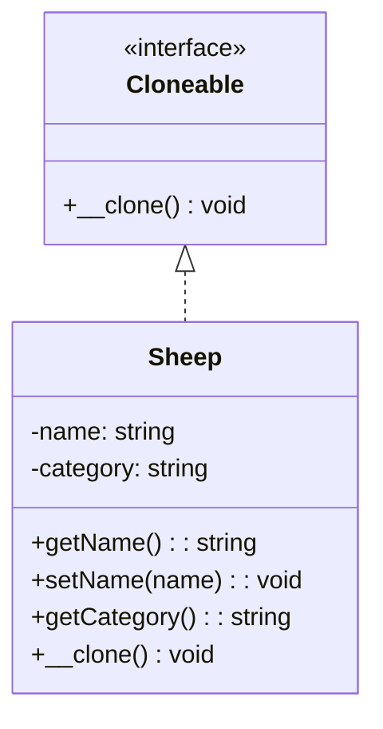

#### 💻 Production-Grade Code

```php
<?php

declare(strict_types=1);

final class Sheep
{
    public function __construct(
        private string $name,
        private string $category = 'Mountain Sheep'
    ) {}

    public function setName(string $name): void
    {
        $this->name = $name;
    }

    public function getName(): string
    {
        return $this->name;
    }

    public function getCategory(): string
    {
        return $this->category;
    }

    // Handles shallow vs deep copying of inner objects if present
    public function __clone()
    {
        // Custom clone logic if properties include object references
    }
}

// Client Execution
$originalSheep = new Sheep('Jolly');
echo sprintf("Original: %s (%s)\n", $originalSheep->getName(), $originalSheep->getCategory());

// Cloning via Prototype
$clonedSheep = clone $originalSheep;
$clonedSheep->setName('Dolly');

echo sprintf("Cloned:   %s (%s)\n", $clonedSheep->getName(), $clonedSheep->getCategory());
```

#### ⚖️ Trade-offs & Analysis
* **Advantages:** Bypasses expensive constructor logic; enables dynamic object copying at runtime.
* **Disadvantages:** Deep cloning complex objects containing circular references or external resource handles (sockets, open files) is treacherous.
* **Industry Precedent:** JavaScript's prototypical inheritance system; Java's `Object.clone()`; game engine prefab instantiation (Unity).

---

### 6. Singleton

> **Intent:** Ensures a class has only one instance and provides a global point of access to it.

#### 🌍 Real-World Analogy
A sovereign nation can only have one active President or Prime Minister at any given instant. Whenever commands or executive decrees are issued, they flow through that single verified executive office, avoiding conflicting parallel administrations.

#### 🎯 Problem & Motivation
Certain system resources must be coordinated through exactly one shared authority (e.g., a hardware driver, connection pool limiter, or shared in-memory metrics collector). Multiple instances would corrupt shared state.

#### 📐 Architecture & Diagram

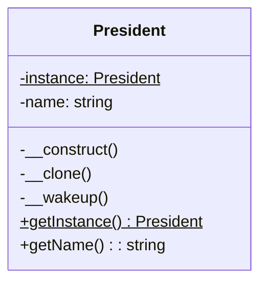

#### 💻 Production-Grade Code

```php
<?php

declare(strict_types=1);

final class President
{
    private static ?self $instance = null;

    // Private constructor blocks direct instantiation
    private function __construct(private readonly string $name = 'Elected Official') {}

    // Disable cloning
    private function __clone() {}

    // Disable unserialization
    public function __wakeup()
    {
        throw new \Exception("Cannot unserialize singleton");
    }

    public static function getInstance(): self
    {
        if (self::$instance === null) {
            self::$instance = new self();
        }

        return self::$instance;
    }

    public function issueDirective(string $directive): string
    {
        return sprintf("[%s] Directive: %s", $this->name, $directive);
    }
}

// Client Execution
$president1 = President::getInstance();
$president2 = President::getInstance();

var_dump($president1 === $president2); // bool(true) - Exactly the same memory pointer!
echo $president1->issueDirective("Deploy disaster recovery response.") . PHP_EOL;
```

#### ⚖️ Trade-offs & Analysis
* **Advantages:** Strict control over shared resource allocation; lazy initialization saves memory until first use.
* **Disadvantages:** Often considered an anti-pattern when overused: introduces hidden global state, severely impairs unit testing (mocking is difficult), and violates the Single Responsibility Principle. Prefer Dependency Injection wherever feasible.
* **Industry Precedent:** `Runtime.getRuntime()` in Java; application service containers (e.g. Laravel Service Container, Spring singleton beans).

---

# 🧩 Structural Design Patterns

> Structural patterns focus on how classes and objects are composed to form larger, more flexible, and decoupled structures. They ensure that when parts change, the whole structure remains intact.

<p align="center">
  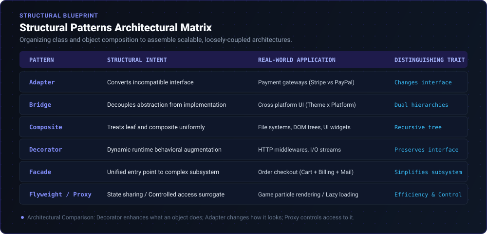
</p>

---

### 7. Adapter

> **Intent:** Converts the interface of a class into another interface clients expect, enabling incompatible classes to work together.

#### 🌍 Real-World Analogy
When traveling from North America to the United Kingdom, your laptop's two-prong US plug physically cannot fit into the UK 3-prong wall socket. You do not re-wire your laptop or rebuild the wall outlet. You simply click an international travel plug adapter in-between.

#### 🎯 Problem & Motivation
You integrate a legacy library or modern third-party package into your system. Their method signatures differ from your application's domain interface, but you cannot alter their source code.

#### 📐 Architecture & Diagram

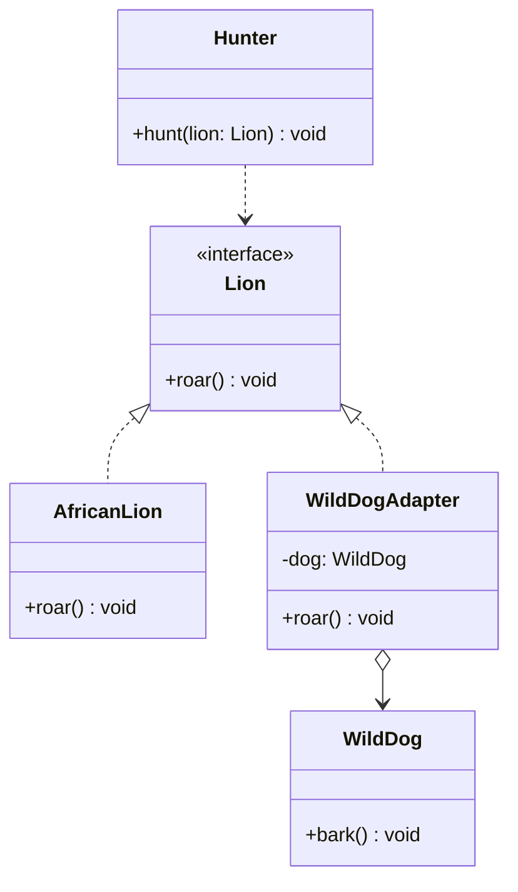

#### 💻 Production-Grade Code

```php
<?php

declare(strict_types=1);

interface Lion
{
    public function roar(): string;
}

final class AfricanLion implements Lion
{
    public function roar(): string
    {
        return "Deep African Lion Roar!";
    }
}

// Incompatible external class (Adaptee)
final class WildDog
{
    public function bark(): string
    {
        return "Sharp Wild Dog Bark!";
    }
}

// The Adapter
final class WildDogAdapter implements Lion
{
    public function __construct(private readonly WildDog $dog) {}

    public function roar(): string
    {
        // Adapts bark() to conform to roar()
        return $this->dog->bark();
    }
}

final class Hunter
{
    public function hunt(Lion $lion): void
    {
        echo "Tracking target sound: " . $lion->roar() . PHP_EOL;
    }
}

// Client Execution
$hunter = new Hunter();
$hunter->hunt(new AfricanLion());

$wildDog = new WildDog();
$dogAdapter = new WildDogAdapter($wildDog);
$hunter->hunt($dogAdapter); // Works seamlessly!
```

#### ⚖️ Trade-offs & Analysis
* **Advantages:** Single Responsibility and Open/Closed compliant; separates interface translation from domain logic.
* **Disadvantages:** Increases structural complexity by adding wrapper classes.
* **Industry Precedent:** `Arrays.asList()` in Java; database adapters in ORMs (PDO, TypeORM); payment gateway normalizers.

---

### 8. Bridge

> **Intent:** Decouples an abstraction from its implementation so that the two can vary independently.

#### 🌍 Real-World Analogy
Consider a website with multiple pages (About Page, Careers Page) and multiple color themes (Dark Theme, Light Theme, High-Contrast Theme). Without a Bridge, you would have to create `DarkAboutPage`, `LightAboutPage`, `DarkCareersPage`, `LightCareersPage` (a combinatorial explosion: $M 	imes N$). By bridging themes through a separate interface, themes and pages evolve independently ($M + N$).

#### 🎯 Problem & Motivation
Inheritance binds an implementation to an abstraction statically at compile time, leading to class proliferation when an abstraction has multiple orthogonal dimensions of variation.

#### 📐 Architecture & Diagram

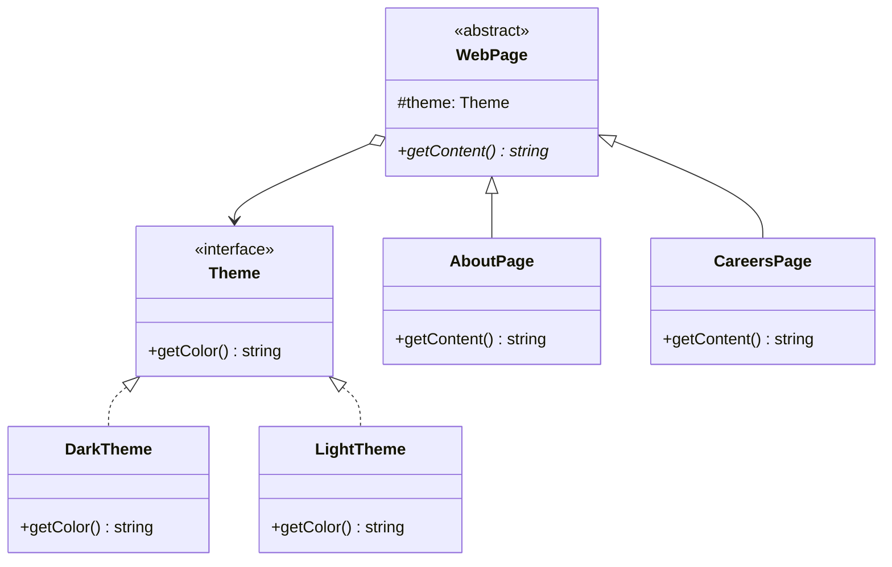

#### 💻 Production-Grade Code

```php
<?php

declare(strict_types=1);

interface Theme
{
    public function getColor(): string;
}

final class DarkTheme implements Theme
{
    public function getColor(): string
    {
        return "Dark Slate Palette (#0f172a)";
    }
}

final class LightTheme implements Theme
{
    public function getColor(): string
    {
        return "Crisp White Palette (#ffffff)";
    }
}

abstract class WebPage
{
    public function __construct(protected readonly Theme $theme) {}

    abstract public function getContent(): string;
}

final class AboutPage extends WebPage
{
    public function getContent(): string
    {
        return sprintf("About Us Page rendered with %s", $this->theme->getColor());
    }
}

final class CareersPage extends WebPage
{
    public function getContent(): string
    {
        return sprintf("Careers Page rendered with %s", $this->theme->getColor());
    }
}

// Client Execution
$darkTheme = new DarkTheme();
$lightTheme = new LightTheme();

$about = new AboutPage($darkTheme);
$careers = new CareersPage($lightTheme);

echo $about->getContent() . PHP_EOL;
echo $careers->getContent() . PHP_EOL;
```

#### ⚖️ Trade-offs & Analysis
* **Advantages:** Avoids Cartesian explosion of classes; allows runtime switching of implementation details; adheres to Dependency Inversion.
* **Disadvantages:** Introduces extra layers of indirection in straightforward systems.
* **Industry Precedent:** Cross-platform GUI backends; graphic drivers (Vulkan vs DirectX vs Metal backends under an abstract Graphics Engine).

---

### 9. Composite

> **Intent:** Composes objects into tree structures to represent part-whole hierarchies, allowing clients to treat individual objects and compositions uniformly.

#### 🌍 Real-World Analogy
An enterprise organization has individual contributors (Developers, Designers) as well as Departments that contain groups of employees and sub-departments. When calculating total operational payroll, the CFO queries the organization tree uniformly: calling `getSalary()` on an individual returns their salary; calling `getSalary()` on a department recursively aggregates the salaries of all members.

#### 🎯 Problem & Motivation
Clients must constantly inspect the type of an item (`if ($item instanceof Folder) ... else ...`) to execute recursive operations, scattering type-checking logic and creating fragile procedural code.

#### 📐 Architecture & Diagram

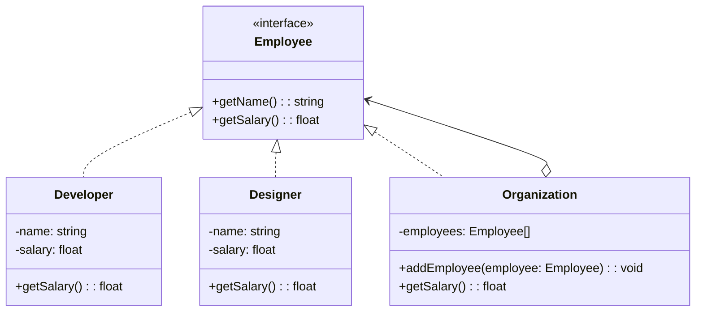

#### 💻 Production-Grade Code

```php
<?php

declare(strict_types=1);

interface Employee
{
    public function getName(): string;
    public function getSalary(): float;
}

final class Developer implements Employee
{
    public function __construct(
        private readonly string $name,
        private readonly float $salary
    ) {}

    public function getName(): string { return $this->name; }
    public function getSalary(): float { return $this->salary; }
}

final class Designer implements Employee
{
    public function __construct(
        private readonly string $name,
        private readonly float $salary
    ) {}

    public function getName(): string { return $this->name; }
    public function getSalary(): float { return $this->salary; }
}

final class Organization implements Employee
{
    /** @var Employee[] */
    private array $employees = [];

    public function __construct(private readonly string $name) {}

    public function addEmployee(Employee $employee): void
    {
        $this->employees[] = $employee;
    }

    public function getName(): string { return $this->name; }

    public function getSalary(): float
    {
        $total = 0.0;
        foreach ($this->employees as $employee) {
            $total += $employee->getSalary();
        }
        return $total;
    }
}

// Client Execution
$leadDev = new Developer('Alex', 120000.0);
$seniorDev = new Developer('Sarah', 110000.0);
$uxDesigner = new Designer('Morgan', 95000.0);

$engineeringDept = new Organization('Engineering Department');
$engineeringDept->addEmployee($leadDev);
$engineeringDept->addEmployee($seniorDev);

$company = new Organization('TechCorp Global');
$company->addEmployee($engineeringDept);
$company->addEmployee($uxDesigner);

echo sprintf("Total Enterprise Payroll: $%.2f\n", $company->getSalary());
```

#### ⚖️ Trade-offs & Analysis
* **Advantages:** Simplifies client logic via polymorphism; easily accommodates new leaf or container components.
* **Disadvantages:** Can make it difficult to restrict which components can be added to specific composite trees at compile time.
* **Industry Precedent:** DOM elements in HTML browsers (`Node`, `Element`); file system trees (Files & Folders); UI view hierarchies (SwiftUI, React virtual DOM).

---

### 10. Decorator

> **Intent:** Attaches additional responsibilities to an object dynamically at runtime without modifying its class or using rigid inheritance.

#### 🌍 Real-World Analogy
When you visit an espresso bar, you start with a base Simple Coffee. You can then wrap that coffee with steamed milk (creating a Latte), wrap it further with caramel drizzle, and top it off with whipped cream. Each topping enriches the flavor and cost, yet the result is still fundamentally a consumable coffee.

#### 🎯 Problem & Motivation
Using class inheritance to combine features causes exponential subclass bloat: `MilkCoffee`, `VanillaMilkCoffee`, `WhipVanillaMilkCoffee`, etc. Furthermore, inheritance is static and cannot be added or removed dynamically at runtime.

#### 📐 Architecture & Diagram

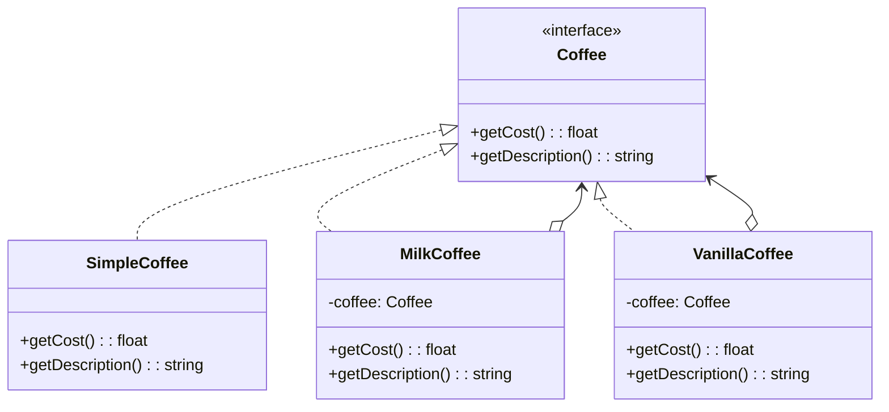

#### 💻 Production-Grade Code

```php
<?php

declare(strict_types=1);

interface Coffee
{
    public function getCost(): float;
    public function getDescription(): string;
}

final class SimpleCoffee implements Coffee
{
    public function getCost(): float
    {
        return 3.50;
    }

    public function getDescription(): string
    {
        return "Artisan Roast Coffee";
    }
}

final class MilkCoffee implements Coffee
{
    public function __construct(private readonly Coffee $coffee) {}

    public function getCost(): float
    {
        return $this->coffee->getCost() + 0.75;
    }

    public function getDescription(): string
    {
        return $this->coffee->getDescription() . ", Steamed Milk";
    }
}

final class VanillaCoffee implements Coffee
{
    public function __construct(private readonly Coffee $coffee) {}

    public function getCost(): float
    {
        return $this->coffee->getCost() + 0.50;
    }

    public function getDescription(): string
    {
        return $this->coffee->getDescription() . ", Madagascar Vanilla";
    }
}

// Client Execution
$drink = new SimpleCoffee();
$drink = new MilkCoffee($drink);
$drink = new VanillaCoffee($drink);

echo sprintf("Order: %s | Total: $%.2f\n", $drink->getDescription(), $drink->getCost());
```

#### ⚖️ Trade-offs & Analysis
* **Advantages:** High runtime flexibility; honors the Open/Closed Principle; prevents subclass explosion.
* **Disadvantages:** Debugging deeply nested decorators can produce complex stack traces; order of wrapping can introduce subtle semantic bugs.
* **Industry Precedent:** Java I/O Streams (`BufferedInputStream(FileInputStream(...))`); HTTP Request/Response Middlewares (Express.js, PSR-15, Rack).

---

### 11. Facade

> **Intent:** Provides a unified, high-level interface to a set of interfaces in a subsystem, making the subsystem easier to consume.

#### 🌍 Real-World Analogy
When you turn the ignition key or press the start button in your automobile, you do not manually inject fuel into the cylinder valves, verify electrical battery voltages, spark the plugs, and engage the transmission clutch. The ignition button is a simple, elegant Facade over a massively intricate electro-mechanical subsystem.

#### 🎯 Problem & Motivation
Directly interacting with dozens of low-level subsystem classes exposes clients to complex internal couplings, making client code brittle to any internal refactoring.

#### 📐 Architecture & Diagram

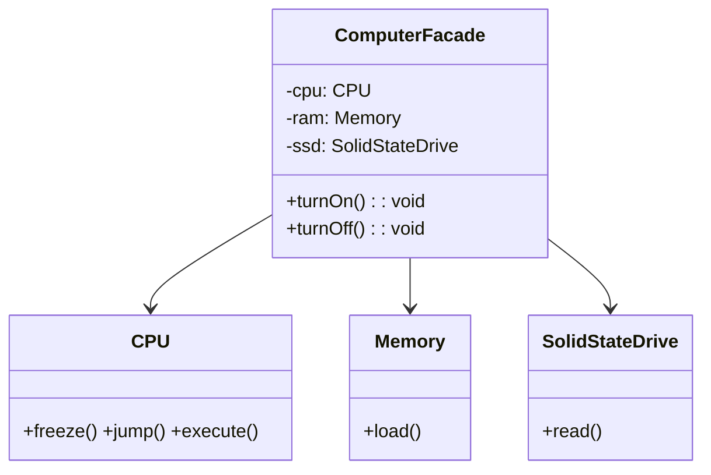

#### 💻 Production-Grade Code

```php
<?php

declare(strict_types=1);

final class CPU
{
    public function freeze(): void { echo "CPU: Halting execution pipeline.\n"; }
    public function jump(string $address): void { echo "CPU: Setting instruction pointer to {$address}.\n"; }
    public function execute(): void { echo "CPU: Executing instructions.\n"; }
}

final class Memory
{
    public function load(string $position, string $data): void
    {
        echo "Memory: Loading data block into {$position}.\n";
    }
}

final class HardDrive
{
    public function read(string $lba, int $size): string
    {
        echo "HardDrive: Reading {$size} bytes from LBA {$lba}.\n";
        return "BOOT_SECTOR_DATA";
    }
}

final class ComputerFacade
{
    public function __construct(
        private readonly CPU $cpu = new CPU(),
        private readonly Memory $ram = new Memory(),
        private readonly HardDrive $disk = new HardDrive()
    ) {}

    public function turnOn(): void
    {
        echo "=== Initiating System Boot via Facade ===\n";
        $this->cpu->freeze();
        $bootData = $this->disk->read("0x0001", 1024);
        $this->ram->load("0x0000", $bootData);
        $this->cpu->jump("0x0000");
        $this->cpu->execute();
        echo "=== System Ready ===\n";
    }
}

// Client Execution
$workstation = new ComputerFacade();
$workstation->turnOn();
```

#### ⚖️ Trade-offs & Analysis
* **Advantages:** Isolates clients from subsystem complexity; creates clear boundaries and reduces coupling.
* **Disadvantages:** Can risk becoming a "God Object" if too many unrelated responsibilities are lumped into a single facade.
* **Industry Precedent:** Laravel Facades (e.g., `Cache::get()`, `Route::post()`); Spring's `RestTemplate` / `JdbcTemplate`.

---

### 12. Flyweight

> **Intent:** Minimizes memory footprint by sharing as much common data as possible with similar objects (intrinsic vs extrinsic state).

#### 🌍 Real-World Analogy
In a forest simulation video game, rendering 1,000,000 individual tree objects would consume gigabytes of memory if each tree held its own 3D mesh, texture maps, and bark bump-maps. In reality, the game stores one single shared 3D tree mesh in memory (intrinsic state) and renders it at 1,000,000 different (X, Y, Z) coordinates (extrinsic state).

#### 🎯 Problem & Motivation
Applications running out of RAM (OutOfMemory crashes) when instantiating millions of small objects that duplicate identical invariant data.

#### 📐 Architecture & Diagram

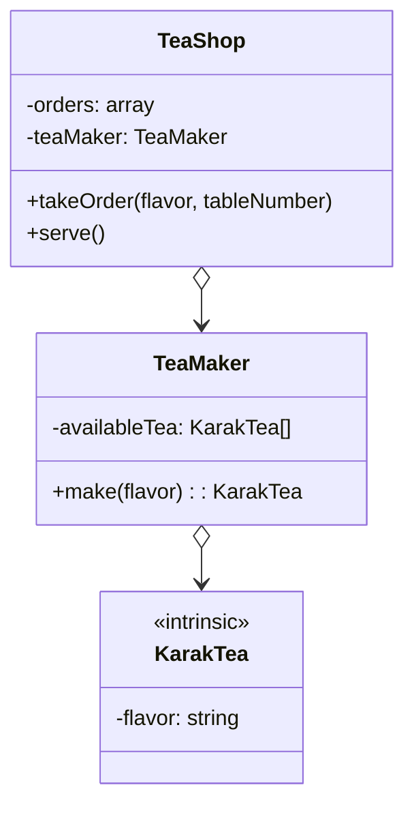

#### 💻 Production-Grade Code

```php
<?php

declare(strict_types=1);

// Intrinsic State: Shared, invariant data
final class KarakTea
{
    public function __construct(public readonly string $flavor) {}
}

// Flyweight Factory
final class TeaMaker
{
    /** @var array<string, KarakTea> */
    private array $availableTea = [];

    public function make(string $flavor): KarakTea
    {
        if (!isset($this->availableTea[$flavor])) {
            $this->availableTea[$flavor] = new KarakTea($flavor);
        }

        return $this->availableTea[$flavor];
    }
}

// Extrinsic State Manager
final class TeaShop
{
    /** @var array<int, KarakTea> */
    private array $tables = [];

    public function __construct(private readonly TeaMaker $teaMaker) {}

    public function takeOrder(string $flavor, int $table): void
    {
        $this->tables[$table] = $this->teaMaker->make($flavor);
    }

    public function serve(): void
    {
        foreach ($this->tables as $table => $tea) {
            echo sprintf("Serving %s tea to Table #%d\n", $tea->flavor, $table);
        }
    }
}

// Client Execution
$teaMaker = new TeaMaker();
$shop = new TeaShop($teaMaker);

$shop->takeOrder('Cardamom Spiced', 1);
$shop->takeOrder('Cardamom Spiced', 2);
$shop->takeOrder('Kashmiri Chai', 3);

$shop->serve();
```

#### ⚖️ Trade-offs & Analysis
* **Advantages:** Massive memory savings when scaling to millions of identical items.
* **Disadvantages:** Code complexity increases because state must be cleanly split between intrinsic (shared) and extrinsic (context-dependent) data.
* **Industry Precedent:** `String.intern()` and integer caching (-128 to 127) in Java; glyph/font rendering caches in graphics libraries.

---

### 13. Proxy

> **Intent:** Provides a surrogate or placeholder for another object to control access, perform lazy loading, authorization, or caching.

#### 🌍 Real-World Analogy
A security access card to an executive floor. You cannot open the heavy vault door directly; you swipe your NFC security badge on the card reader. The proxy scanner checks your clearance credentials, logs your entry timestamp, and only unlocks the physical door if authorized.

#### 🎯 Problem & Motivation
Directly instantiating resource-heavy objects (e.g. video files, remote microservices) on application boot degrades performance, even if the user never accesses that feature during their session.

#### 📐 Architecture & Diagram

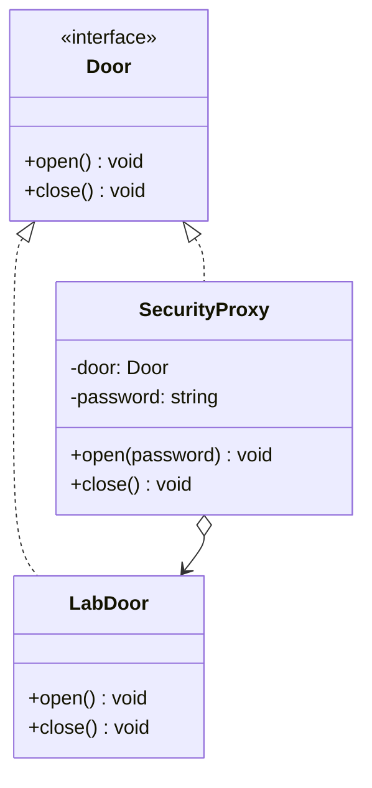

#### 💻 Production-Grade Code

```php
<?php

declare(strict_types=1);

interface Door
{
    public function open(): void;
    public function close(): void;
}

final class LabDoor implements Door
{
    public function open(): void
    {
        echo "Lab Door: Electromagnetic lock released. Door opened.\n";
    }

    public function close(): void
    {
        echo "Lab Door: Door shut and locked securely.\n";
    }
}

final class SecurityProxy implements Door
{
    private ?LabDoor $realDoor = null;

    public function __construct(private readonly string $secretKey) {}

    public function authenticate(string $providedKey): bool
    {
        return hash_equals($this->secretKey, $providedKey);
    }

    public function open(): void
    {
        throw new LogicException("Direct access denied. Call openWithKey().");
    }

    public function openWithKey(string $key): void
    {
        if (!$this->authenticate($key)) {
            echo "Security Alert: Access denied! Invalid credentials.\n";
            return;
        }

        // Lazy initialization of physical resource
        if ($this->realDoor === null) {
            $this->realDoor = new LabDoor();
        }

        $this->realDoor->open();
    }

    public function close(): void
    {
        $this->realDoor?->close();
    }
}

// Client Execution
$securityDoor = new SecurityProxy('$ecr3tP@ss');

$securityDoor->openWithKey('wrong_pass'); // Access denied!
$securityDoor->openWithKey('$ecr3tP@ss'); // Success!
```

#### ⚖️ Trade-offs & Analysis
* **Advantages:** Controls resource lifecycle (virtual proxy); adds security and auditing without modifying target classes (protection proxy); supports distributed stubs (remote proxy).
* **Disadvantages:** Adds latency through another layer of abstraction.
* **Industry Precedent:** Doctrine/Hibernate Lazy-Loading Entities; Nginx reverse proxy; JavaScript `Proxy` API.

---

# ⚡ Behavioral Design Patterns

> Behavioral patterns identify common communication patterns between objects and realize these patterns. By doing so, these patterns increase flexibility in carrying out this communication.

<p align="center">
  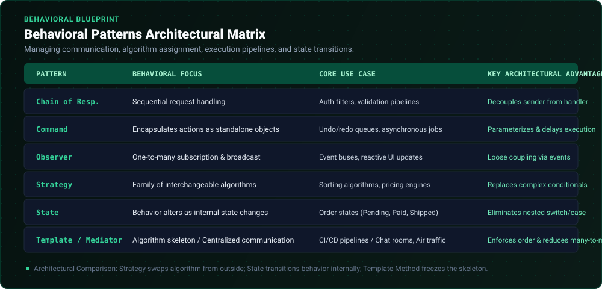
</p>

---

### 14. Chain of Responsibility

> **Intent:** Avoids coupling the sender of a request to its receiver by giving more than one object a chance to handle the request.

#### 🌍 Real-World Analogy
When you pay for an item online, your checkout request checks your account balance: first trying your primary checking account; if funds are insufficient, it cascades to your secondary savings account; if still insufficient, it attempts your backup credit card; if all fail, an exception is thrown.

#### 🎯 Problem & Motivation
A sequence of checks (authentication, role permission, rate limiting, request sanitization) nested within a single monolithic function produces an unmaintainable pyramid of `if/else` statements.

#### 📐 Architecture & Diagram

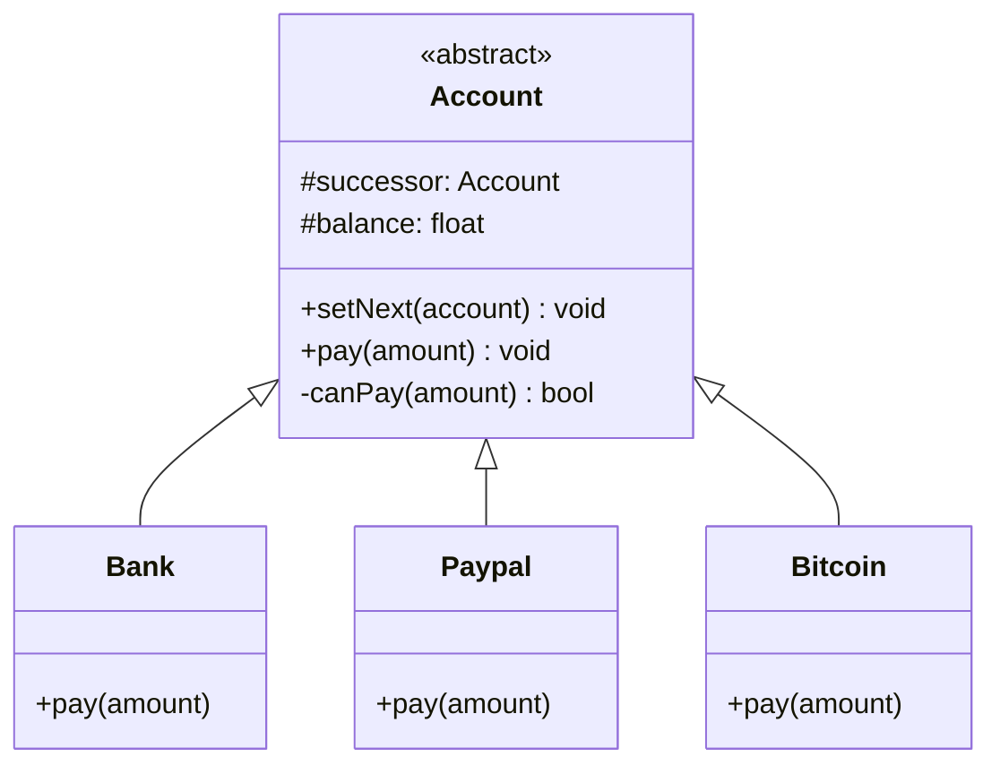

#### 💻 Production-Grade Code

```php
<?php

declare(strict_types=1);

abstract class Account
{
    private ?Account $successor = null;

    public function __construct(protected float $balance) {}

    public function setNext(Account $account): Account
    {
        $this->successor = $account;
        return $account;
    }

    public function pay(float $amountToPay): void
    {
        if ($this->canPay($amountToPay)) {
            echo sprintf("Processed payment of $%.2f using %s.\n", $amountToPay, static::class);
            $this->balance -= $amountToPay;
            return;
        }

        if ($this->successor !== null) {
            echo sprintf("Insufficient funds in %s. Escalating to next payment handler...\n", static::class);
            $this->successor->pay($amountToPay);
            return;
        }

        throw new RuntimeException("Transaction declined: No linked accounts have sufficient funds.");
    }

    protected function canPay(float $amount): bool
    {
        return $this->balance >= $amount;
    }
}

final class BankAccount extends Account {}
final class PaypalAccount extends Account {}
final class CryptoAccount extends Account {}

// Client Execution: Assemble the chain
$bank = new BankAccount(100.0);
$paypal = new PaypalAccount(250.0);
$crypto = new CryptoAccount(1000.0);

$bank->setNext($paypal)->setNext($crypto);

$bank->pay(200.0); // Paid via PayPal!
```

#### ⚖️ Trade-offs & Analysis
* **Advantages:** Decouples sender and receiver; adheres to the Single Responsibility and Open/Closed principles; dynamic chain reconfiguration.
* **Disadvantages:** No guarantee that a request will be handled if the chain reaches the end without a match.
* **Industry Precedent:** Web framework HTTP middleware stacks (Koa, Express, Laravel Pipeline, Spring Security Filter Chain).

---

### 15. Command

> **Intent:** Encapsulates a request as an object, thereby letting you parameterize clients with different requests, queue or log requests, and support undoable operations.

#### 🌍 Real-World Analogy
Consider a universal smart remote control. The buttons on the remote do not know the technical radio protocol for dimming living room LED bulbs or turning on a soundbar. The remote merely invokes `execute()` on whatever Command object is mapped to a button.

#### 🎯 Problem & Motivation
Coupling UI buttons directly to backend domain actions prevents building features like Undo/Redo history, background job queuing, scheduled execution, or macro scripting.

#### 📐 Architecture & Diagram

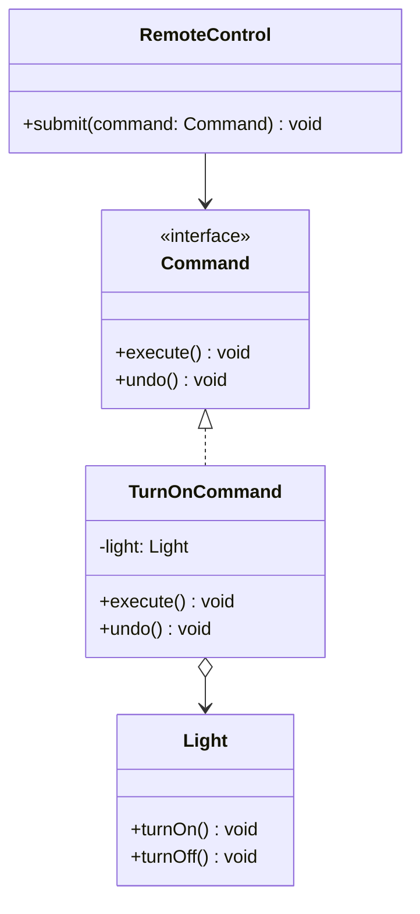

#### 💻 Production-Grade Code

```php
<?php

declare(strict_types=1);

// Receiver
final class Bulb
{
    public function turnOn(): void { echo "Bulb: Emitting warm light.\n"; }
    public function turnOff(): void { echo "Bulb: Darkness restored.\n"; }
}

interface Command
{
    public function execute(): void;
    public function undo(): void;
    public function redo(): void;
}

final class TurnOnCommand implements Command
{
    public function __construct(private readonly Bulb $bulb) {}

    public function execute(): void { $this->bulb->turnOn(); }
    public function undo(): void { $this->bulb->turnOff(); }
    public function redo(): void { $this->execute(); }
}

final class TurnOffCommand implements Command
{
    public function __construct(private readonly Bulb $bulb) {}

    public function execute(): void { $this->bulb->turnOff(); }
    public function undo(): void { $this->bulb->turnOn(); }
    public function redo(): void { $this->execute(); }
}

// Invoker
final class RemoteControl
{
    public function submit(Command $command): void
    {
        $command->execute();
    }
}

// Client Execution
$bulb = new Bulb();
$remote = new RemoteControl();

$turnOn = new TurnOnCommand($bulb);
$turnOff = new TurnOffCommand($bulb);

$remote->submit($turnOn);
$remote->submit($turnOff);
```

#### ⚖️ Trade-offs & Analysis
* **Advantages:** Decouples invoker from receivers; natively enables transaction queues, history stacks, and undoable operations.
* **Disadvantages:** Proliferation of small command classes.
* **Industry Precedent:** Redux/Flux Actions; database migration scripts; GUI menu shortcut architectures.

---

### 16. Iterator

> **Intent:** Provides a way to access the elements of an aggregate object sequentially without exposing its underlying representation.

#### 🌍 Real-World Analogy
A car radio tuner. You press the "Next Station" or "Previous Station" button to cycle through frequencies. You do not need to understand whether the stations are stored in a linked list, a hash table, or scanned dynamically over radio frequencies.

#### 🎯 Problem & Motivation
Exposing internal collection structures (arrays, binary trees, graphs) couples client algorithms to specific data storage formats, preventing internal optimizations.

#### 📐 Architecture & Diagram

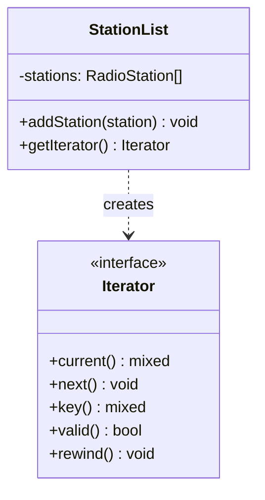

#### 💻 Production-Grade Code

```php
<?php

declare(strict_types=1);

final class RadioStation
{
    public function __construct(public readonly float $frequency) {}
}

final class StationList implements \Iterator
{
    /** @var RadioStation[] */
    private array $stations = [];
    private int $counter = 0;

    public function addStation(RadioStation $station): void
    {
        $this->stations[] = $station;
    }

    public function current(): RadioStation
    {
        return $this->stations[$this->counter];
    }

    public function next(): void
    {
        $this->counter++;
    }

    public function key(): int
    {
        return $this->counter;
    }

    public function valid(): bool
    {
        return isset($this->stations[$this->counter]);
    }

    public function rewind(): void
    {
        $this->counter = 0;
    }
}

// Client Execution
$radio = new StationList();
$radio->addStation(new RadioStation(89.5));
$radio->addStation(new RadioStation(101.1));
$radio->addStation(new RadioStation(104.7));

foreach ($radio as $station) {
    echo sprintf("Tuned to frequency: %.1f MHz\n", $station->frequency);
}
```

#### ⚖️ Trade-offs & Analysis
* **Advantages:** Single Responsibility compliant; supports parallel traversals of the same data structure without collision.
* **Disadvantages:** Overkill for simple flat arrays where native language iterables already suffice.
* **Industry Precedent:** `java.util.Iterator`; Python generators & `__iter__()`; C++ STL iterators.

---

### 17. Mediator

> **Intent:** Defines an object that encapsulates how a set of objects interact, promoting loose coupling by keeping objects from referring to each other explicitly.

#### 🌍 Real-World Analogy
Airport Air Traffic Control (ATC). Commercial airplanes do not radio dozens of other planes directly in mid-air to negotiate runway landings. All pilots communicate exclusively with the central ATC tower, which coordinates landings and takeoffs safely.

#### 🎯 Problem & Motivation
When dozens of UI widgets or microservice components communicate directly in a many-to-many mesh, the system degrades into unmaintainable "spaghetti wiring."

#### 📐 Architecture & Diagram

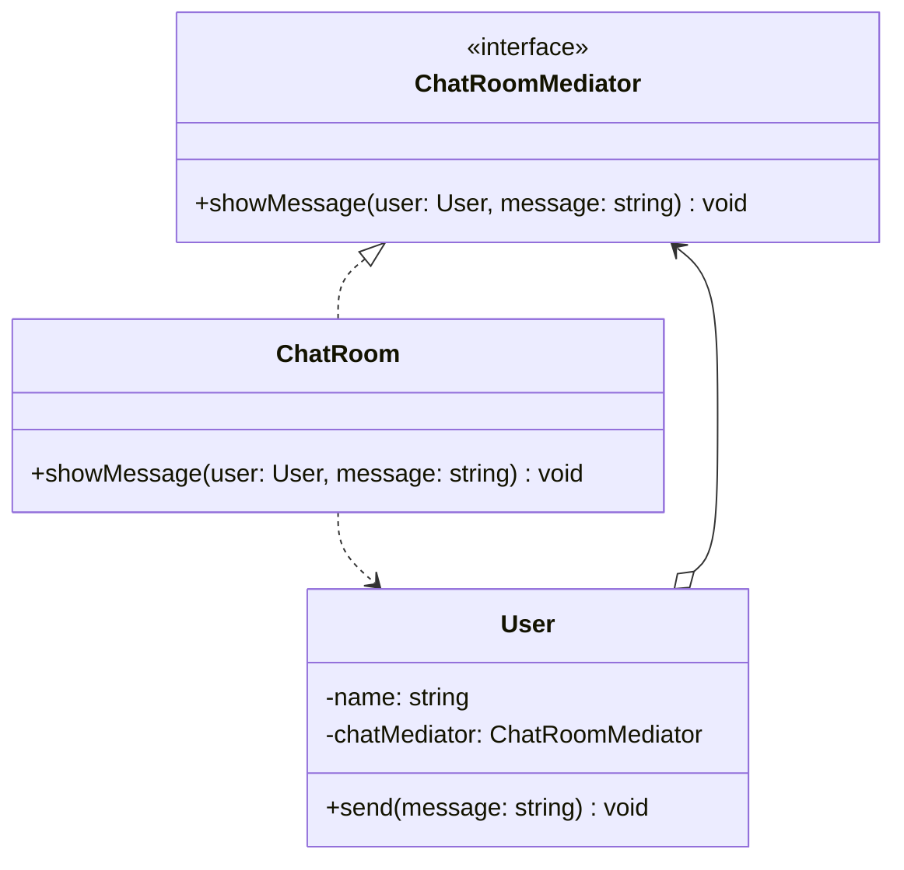

#### 💻 Production-Grade Code

```php
<?php

declare(strict_types=1);

interface ChatRoomMediator
{
    public function showMessage(User $user, string $message): void;
}

final class ChatRoom implements ChatRoomMediator
{
    public function showMessage(User $user, string $message): void
    {
        $timestamp = date('H:i');
        echo sprintf("[%s] %s: %s\n", $timestamp, $user->getName(), $message);
    }
}

final class User
{
    public function __construct(
        private readonly string $name,
        private readonly ChatRoomMediator $chatMediator
    ) {}

    public function getName(): string
    {
        return $this->name;
    }

    public function send(string $message): void
    {
        $this->chatMediator->showMessage($this, $message);
    }
}

// Client Execution
$mediator = new ChatRoom();

$john = new User('John', $mediator);
$jane = new User('Jane', $mediator);

$john->send("Runway 24L cleared for landing.");
$jane->send("Acknowledged Tower. Descending.");
```

#### ⚖️ Trade-offs & Analysis
* **Advantages:** Replaces $O(N^2)$ mesh relationships with $O(N)$ hub-and-spoke coordination; centralizes interaction protocols.
* **Disadvantages:** The Mediator can easily evolve into a monolithic, bloated God Object if responsibilities are not partitioned.
* **Industry Precedent:** MediatR library in .NET; Spring MVC `DispatcherServlet`; Message Brokers (RabbitMQ, Kafka exchange brokers).

---

### 18. Memento

> **Intent:** Without violating encapsulation, captures and externalizes an object's internal state so that the object can be restored to this state later.

#### 🌍 Real-World Analogy
A code editor or word processor's Undo buffer ($Ctrl+Z$). As you type, the editor periodically saves an immutable snapshot (Memento) of the text canvas. When you make a mistake, you revert the canvas to the previously recorded snapshot.

#### 🎯 Problem & Motivation
Saving an object's internal state by exposing its private fields via getters/setters shatters OOP encapsulation and leaks internal implementation details.

#### 📐 Architecture & Diagram

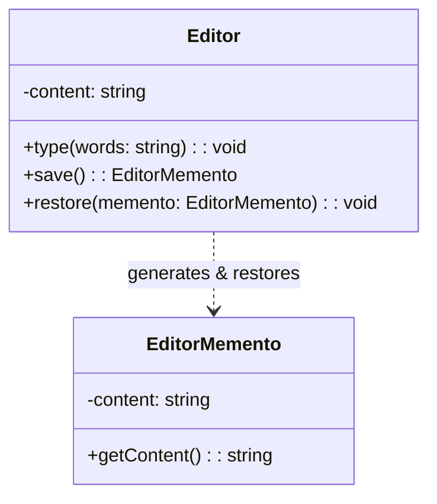

#### 💻 Production-Grade Code

```php
<?php

declare(strict_types=1);

// Immutable Snapshot
final class EditorMemento
{
    public function __construct(private readonly string $content) {}

    public function getContent(): string
    {
        return $this->content;
    }
}

// Originator
final class Editor
{
    private string $content = '';

    public function type(string $words): void
    {
        $this->content .= $words;
    }

    public function getContent(): string
    {
        return $this->content;
    }

    public function save(): EditorMemento
    {
        return new EditorMemento($this->content);
    }

    public function restore(EditorMemento $memento): void
    {
        $this->content = $memento->getContent();
    }
}

// Client Execution
$editor = new Editor();

$editor->type("Initial draft paragraph.\n");
$savedCheckpoint = $editor->save();

$editor->type("Accidental catastrophic typo.");
echo "Current Text:\n" . $editor->getContent() . PHP_EOL;

// Revert
$editor->restore($savedCheckpoint);
echo "Restored Text:\n" . $editor->getContent() . PHP_EOL;
```

#### ⚖️ Trade-offs & Analysis
* **Advantages:** Preserves state boundaries and full encapsulation; simplifies undo/redo management.
* **Disadvantages:** Storing frequent, massive snapshots in memory can cause significant RAM consumption.
* **Industry Precedent:** Git commit tree objects; database rollback savepoints (`SAVEPOINT`); browser history state API.

---

### 19. Observer

> **Intent:** Defines a one-to-many dependency between objects so that when one object changes state, all its dependents are notified and updated automatically.

#### 🌍 Real-World Analogy
Job listing alerts or YouTube channel subscriptions. Instead of visiting a company's career page every 5 minutes to see if a job has opened, you subscribe with your email. Whenever a new role is published, the notification server automatically broadcasts an email alert to all subscribers.

#### 🎯 Problem & Motivation
Polling an object for state changes wastes CPU cycles and battery life. Hardcoding subscriber lists inside the subject couples the publisher to concrete listener classes.

#### 📐 Architecture & Diagram

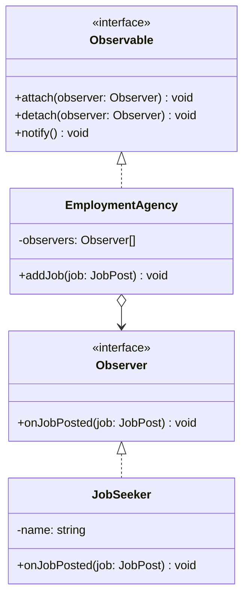

#### 💻 Production-Grade Code

```php
<?php

declare(strict_types=1);

final class JobPost
{
    public function __construct(public readonly string $title) {}
}

interface JobObserver
{
    public function onJobPosted(JobPost $job): void;
}

final class JobSeeker implements JobObserver
{
    public function __construct(private readonly string $name) {}

    public function onJobPosted(JobPost $job): void
    {
        echo sprintf("Notification to %s: New position available -> '%s'\n", $this->name, $job->title);
    }
}

final class EmploymentAgency
{
    /** @var JobObserver[] */
    private array $observers = [];

    public function attach(JobObserver $observer): void
    {
        $this->observers[] = $observer;
    }

    public function addJob(JobPost $jobPosting): void
    {
        $this->notify($jobPosting);
    }

    private function notify(JobPost $jobPosting): void
    {
        foreach ($this->observers as $observer) {
            $observer->onJobPosted($jobPosting);
        }
    }
}

// Client Execution
$agency = new EmploymentAgency();
$agency->attach(new JobSeeker('David'));
$agency->attach(new JobSeeker('Elena'));

$agency->addJob(new JobPost('Principal Systems Architect'));
```

#### ⚖️ Trade-offs & Analysis
* **Advantages:** Realizes the Open/Closed Principle; supports loose coupling between event publishers and listeners.
* **Disadvantages:** Subscribers must be cleaned up (detached), otherwise dormant listeners cause memory leaks (the "Lapsed Listener Problem").
* **Industry Precedent:** Node.js `EventEmitter`; RxJS Observables; DOM event listeners (`addEventListener`); Android BroadcastReceivers.

---

### 20. Visitor

> **Intent:** Represents an operation to be performed on the elements of an object structure. Lets you define a new operation without changing the classes of the elements on which it operates (Double Dispatch).

#### 🌍 Real-World Analogy
A foreign tourist visiting a national zoo. The animals (Monkeys, Lions, Dolphins) do not change their biological anatomy when observed. Instead, the Visitor (the tourist) performs specific actions when visiting each animal (taking photographs of the lion, waving at the monkey).

#### 🎯 Problem & Motivation
You need to add new operations (export to XML, render to SVG, compute tax) across a large object hierarchy. Mutating 20+ classes every time a new operation is needed breaks the Open/Closed Principle and pollutes classes with unrelated domain logic.

#### 📐 Architecture & Diagram

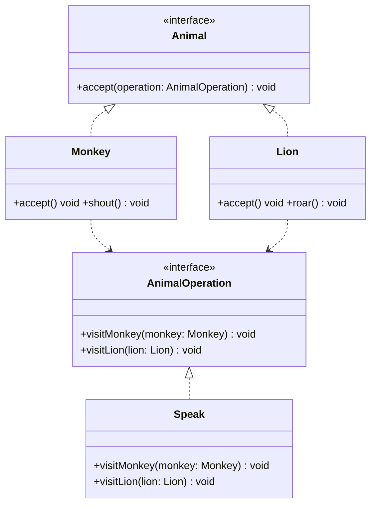

#### 💻 Production-Grade Code

```php
<?php

declare(strict_types=1);

interface AnimalOperation
{
    public function visitMonkey(Monkey $monkey): void;
    public function visitLion(Lion $lion): void;
}

interface Animal
{
    public function accept(AnimalOperation $operation): void;
}

final class Monkey implements Animal
{
    public function shout(): void
    {
        echo "Ooh oo aa aa!\n";
    }

    public function accept(AnimalOperation $operation): void
    {
        $operation->visitMonkey($this);
    }
}

final class Lion implements Animal
{
    public function roar(): void
    {
        echo "Roaaar!\n";
    }

    public function accept(AnimalOperation $operation): void
    {
        $operation->visitLion($this);
    }
}

// New operation added WITHOUT touching Monkey or Lion classes!
final class SpeakOperation implements AnimalOperation
{
    public function visitMonkey(Monkey $monkey): void
    {
        $monkey->shout();
    }

    public function visitLion(Lion $lion): void
    {
        $lion->roar();
    }
}

// Client Execution
$zoo = [new Monkey(), new Lion()];
$speak = new SpeakOperation();

foreach ($zoo as $animal) {
    $animal->accept($speak);
}
```

#### ⚖️ Trade-offs & Analysis
* **Advantages:** Simplifies adding new operations across complex object structures; groups related operations cleanly together.
* **Disadvantages:** Extremely difficult to maintain if new concrete element classes (e.g. `Elephant`) are frequently added to the hierarchy, as every visitor interface must be altered.
* **Industry Precedent:** Abstract Syntax Tree (AST) compilers (Babel, Roslyn, TypeScript compiler passes); document exporters.

---

### 21. Strategy

> **Intent:** Defines a family of algorithms, encapsulates each one, and makes them interchangeable. Strategy lets the algorithm vary independently from clients that use it.

#### 🌍 Real-World Analogy
Navigating to an airport. Depending on your current budget and traffic constraints, you can select different navigation strategies: taking the subway, driving your personal car, or calling a rideshare cab. The destination is identical, but the transport algorithm varies dynamically based on runtime context.

#### 🎯 Problem & Motivation
Hardcoding algorithmic variants inside a monolithic class using cascading `switch/case` statements makes the code brittle, hard to test, and in direct violation of the Open/Closed Principle.

#### 📐 Architecture & Diagram

```mermaid
classDiagram
    class SortStrategy {
        <<interface>>
        +sort(dataset: array): array
    }
    class BubbleSortStrategy { +sort(dataset): array }
    class QuickSortStrategy { +sort(dataset): array }

    class Sorter {
        -strategy: SortStrategy
        +setStrategy(strategy: SortStrategy): void
        +sort(dataset: array): array
    }

    SortStrategy <|.. BubbleSortStrategy
    SortStrategy <|.. QuickSortStrategy
    Sorter o--> SortStrategy
```

#### 💻 Production-Grade Code

```php
<?php

declare(strict_types=1);

interface SortStrategy
{
    /**
     * @param int[] $dataset
     * @return int[]
     */
    public function sort(array $dataset): array;
}

final class BubbleSortStrategy implements SortStrategy
{
    public function sort(array $dataset): array
    {
        echo "Sorting small dataset using Bubble Sort (In-memory stable)...\n";
        sort($dataset);
        return $dataset;
    }
}

final class QuickSortStrategy implements SortStrategy
{
    public function sort(array $dataset): array
    {
        echo "Sorting massive dataset using Quick Sort (O(N log N) divide-and-conquer)...\n";
        sort($dataset);
        return $dataset;
    }
}

final class Sorter
{
    public function __construct(private SortStrategy $strategy) {}

    public function setStrategy(SortStrategy $strategy): void
    {
        $this->strategy = $strategy;
    }

    /**
     * @param int[] $dataset
     * @return int[]
     */
    public function executeSort(array $dataset): array
    {
        return $this->strategy->sort($dataset);
    }
}

// Client Execution
$data = [5, 2, 8, 1, 9];

$sorter = new Sorter(new BubbleSortStrategy());
$sorter->executeSort($data);

// Switch algorithm dynamically at runtime
$sorter->setStrategy(new QuickSortStrategy());
$sorter->executeSort($data);
```

#### ⚖️ Trade-offs & Analysis
* **Advantages:** Cleanly separates algorithm implementation from calling context; eliminates conditional branches; allows runtime algorithm swapping.
* **Disadvantages:** Clients must understand how strategies differ in order to select the right one.
* **Industry Precedent:** Passport.js authentication strategies; payment processors; layout managers in GUI frameworks.

---

### 22. State

> **Intent:** Allows an object to alter its behavior when its internal state changes. The object will appear to change its class.

#### 🌍 Real-World Analogy
A smartphone. When the phone is in an Unlocked state, tapping the screen launches an app. When the phone is in a Screen-Locked state, tapping the screen displays the clock and a lock icon. When the phone is in a Powered-Off state, tapping the screen does nothing. The screen is identical, but its behavior changes based on internal state.

#### 🎯 Problem & Motivation
Objects containing giant state machines littered with `if ($this->state === 'PENDING') ... else if ($this->state === 'SHIPPED')` become nightmarish to debug, with invalid state transitions easily creeping into production.

#### 📐 Architecture & Diagram

```mermaid
classDiagram
    class PhoneState {
        <<interface>>
        +pickUp(): PhoneState
        +hangUp(): PhoneState
        +dial(): PhoneState
    }
    class StateIdle { +pickUp() +hangUp() +dial() }
    class StatePickedUp { +pickUp() +hangUp() +dial() }
    class StateCalling { +pickUp() +hangUp() +dial() }

    class Phone {
        -state: PhoneState
        +setState(state)
        +pickUp()
        +hangUp()
        +dial()
    }

    PhoneState <|.. StateIdle
    PhoneState <|.. StatePickedUp
    PhoneState <|.. StateCalling
    Phone o--> PhoneState
```

#### 💻 Production-Grade Code

```php
<?php

declare(strict_types=1);

interface PhoneState
{
    public function pickUp(): PhoneState;
    public function hangUp(): PhoneState;
    public function dial(): PhoneState;
}

final class PhoneStateIdle implements PhoneState
{
    public function pickUp(): PhoneState
    {
        echo "Phone off hook: Dial tone sounding.\n";
        return new PhoneStatePickedUp();
    }

    public function hangUp(): PhoneState
    {
        throw new LogicException("Already on hook.");
    }

    public function dial(): PhoneState
    {
        throw new LogicException("Cannot dial without picking up handset.");
    }
}

final class PhoneStatePickedUp implements PhoneState
{
    public function pickUp(): PhoneState
    {
        throw new LogicException("Handset is already picked up.");
    }

    public function hangUp(): PhoneState
    {
        echo "Handset replaced: Returning to Idle state.\n";
        return new PhoneStateIdle();
    }

    public function dial(): PhoneState
    {
        echo "Dialing tones sent: Connecting call...\n";
        return new PhoneStateCalling();
    }
}

final class PhoneStateCalling implements PhoneState
{
    public function pickUp(): PhoneState
    {
        throw new LogicException("Call is already in progress.");
    }

    public function hangUp(): PhoneState
    {
        echo "Call terminated: Returning to Idle state.\n";
        return new PhoneStateIdle();
    }

    public function dial(): PhoneState
    {
        throw new LogicException("Line busy with active call.");
    }
}

final class Phone
{
    private PhoneState $state;

    public function __construct()
    {
        $this->state = new PhoneStateIdle();
    }

    public function pickUp(): void { $this->state = $this->state->pickUp(); }
    public function hangUp(): void { $this->state = $this->state->hangUp(); }
    public function dial(): void { $this->state = $this->state->dial(); }
}

// Client Execution
$phone = new Phone();
$phone->pickUp();
$phone->dial();
$phone->hangUp();
```

#### ⚖️ Trade-offs & Analysis
* **Advantages:** Encapsulates state-specific transitions cleanly; eliminates nested conditionals; makes invalid state transitions mathematically impossible.
* **Disadvantages:** Can be overkill if a state machine only contains 2 simple states with no diverging transitions.
* **Industry Precedent:** Finite State Machines (XState, Spring StateMachine); TCP connection state handlers (LISTEN, ESTABLISHED, CLOSE_WAIT).

---

### 23. Template Method

> **Intent:** Defines the skeleton of an algorithm in an operation, deferring some steps to subclasses. Template Method lets subclasses redefine certain steps of an algorithm without changing the algorithm's structure.

#### 🌍 Real-World Analogy
Constructing a pre-fabricated modular home. The architectural sequence of steps is fixed and immutable: 1) Lay foundation, 2) Erect framing, 3) Install electrical & plumbing, 4) Apply exterior facade. A contractor cannot install the roof before pouring the foundation, but they can customize step 4 by selecting either brick, stone, or timber siding.

#### 🎯 Problem & Motivation
Multiple classes execute an identical sequence of steps with only minor variations in individual operations. Duplicating the entire sequence leads to algorithm drift and maintenance regressions.

#### 📐 Architecture & Diagram

```mermaid
classDiagram
    class BuilderPipeline {
        <<abstract>>
        +build() void
        #test()* void
        #lint()* void
        #assemble()* void
        #deploy()* void
    }
    class AndroidBuilder {
        #test() void
        #lint() void
        #assemble() void
        #deploy() void
    }
    class IosBuilder {
        #test() void
        #lint() void
        #assemble() void
        #deploy() void
    }

    BuilderPipeline <|-- AndroidBuilder
    BuilderPipeline <|-- IosBuilder
```

#### 💻 Production-Grade Code

```php
<?php

declare(strict_types=1);

abstract class BuildPipeline
{
    // The Template Method: marked 'final' to prevent subclasses from altering the sequence!
    final public function build(): void
    {
        $this->test();
        $this->lint();
        $this->assemble();
        $this->deploy();
    }

    abstract protected function test(): void;
    abstract protected function lint(): void;
    abstract protected function assemble(): void;
    abstract protected function deploy(): void;
}

final class AndroidBuilder extends BuildPipeline
{
    protected function test(): void { echo "Running Android JUnit & Instrumented Tests.\n"; }
    protected function lint(): void { echo "Running Android Lint analysis.\n"; }
    protected function assemble(): void { echo "Compiling Gradle release APK & AAB.\n"; }
    protected function deploy(): void { echo "Uploading build artifacts to Google Play Console.\n"; }
}

final class IosBuilder extends BuildPipeline
{
    protected function test(): void { echo "Executing XCTest test suite.\n"; }
    protected function lint(): void { echo "Running SwiftLint static rules.\n"; }
    protected function assemble(): void { echo "Signing and archiving IPA package.\n"; }
    protected function deploy(): void { echo "Distributing via TestFlight & App Store Connect.\n"; }
}

// Client Execution
echo "=== Android Pipeline ===\n";
(new AndroidBuilder())->build();

echo "\n=== iOS Pipeline ===\n";
(new IosBuilder())->build();
```

#### ⚖️ Trade-offs & Analysis
* **Advantages:** Eliminates algorithm duplication; enforces an invariant structural workflow (Hollywood Principle: *"Don't call us, we'll call you"*).
* **Disadvantages:** Can be restrictive because subclasses are bound to the skeleton defined by the parent class; violates composition over inheritance if overused.
* **Industry Precedent:** Framework lifecycles (e.g. React `Component.render()`, JUnit `setUp()` / `tearDown()`, Django class-based views).

---

## 🎯 Summary Comparison Matrices

### Creational: Factory Comparison

| Dimension | Simple Factory | Factory Method | Abstract Factory |
| :--- | :--- | :--- | :--- |
| **GoF Status** | Idiom / Architectural Pattern | Formal GoF Pattern | Formal GoF Pattern |
| **Mechanism** | Static helper or single class | Inheritance / Subclasses | Object Composition |
| **Scope** | Single product instance | Single product instance | Family of related products |
| **Coupling** | Direct helper dependency | Subclass specialization | Interface abstraction |

### Structural: Wrapper Comparison

| Pattern | Primary Objective | Interface Transformation |
| :--- | :--- | :--- |
| **Adapter** | Compatibility between mismatched interfaces | **Changes** the interface to match target expectation |
| **Decorator** | Adds dynamic behavior without subclassing | **Preserves** and wraps the identical interface |
| **Proxy** | Controls access, caching, or lazy initialization | **Preserves** identical interface with access guard |
| **Facade** | Simplifies complex subsystem consumption | **Provides a brand new**, simplified high-level interface |

### Behavioral: Algorithm & State Comparison

| Pattern | How It Operates | Who Controls Changes |
| :--- | :--- | :--- |
| **Strategy** | Swaps entire algorithm implementation | External client selects and injects strategy |
| **State** | Alters behavior as internal condition mutates | State objects or context manage state transitions |
| **Command** | Bundles an action into an invokable object | Sender triggers; Invoker queues or replays |
| **Template Method** | Fixes algorithm skeleton, allows step override | Subclasses override specific hook methods |

---

## 🤝 Community & Open-Source Contributions

**PatternCraft** thrives because of engineers, educators, and open-source contributors around the globe:
- 💡 **Open an Issue** on [GitHub Issues](https://github.com/Rahulchaube1/PatternCraft/issues) to report bugs, suggest architecture refinements, or propose new design paradigms.
- 🚀 **Submit a Pull Request** with language implementations (Python, TypeScript, Go, Rust, Java, C#) by checking out our [Contributing Guide](CONTRIBUTING.md).
- ⭐ **Star this Repository:** If this guide leveled up your understanding of system design, architecture, or object-oriented software engineering, please star the project on [GitHub](https://github.com/Rahulchaube1/PatternCraft)!

---

## 👨‍💻 Author & Maintainer

<table border="0">
  <tr>
    <td width="100" align="center" valign="middle">
      
    </td>
    <td valign="middle">
      <h3>Rahul Chaube</h3>
      <p>Software Engineer &amp; Systems Architect dedicated to building robust developer ecosystems, high-scale software architectures, and open-source tools.</p>
      <p>
        <a href="https://rahulchaube1.com"></a>
        <a href="https://github.com/Rahulchaube1"></a>
        <a href="https://www.linkedin.com/in/rahulchaube1/"></a>
        <a href="https://buymeacoffee.com/rahulchaube"></a>
      </p>
    </td>
  </tr>
</table>

### 🌐 Connect & Follow
* **Portfolio:** [https://rahulchaube1.com](https://rahulchaube1.com)
* **GitHub:** [https://github.com/Rahulchaube1](https://github.com/Rahulchaube1)
* **LinkedIn:** [https://www.linkedin.com/in/rahulchaube1/](https://www.linkedin.com/in/rahulchaube1/)
* **Buy Me a Coffee:** [https://buymeacoffee.com/rahulchaube](https://buymeacoffee.com/rahulchaube)

---

## 💖 Sponsorship & Product Collaborations

Are you building an innovative engineering product, SaaS platform, or developer tool? We love partnering with technical teams and sponsors who value clean code, developer experience, and open source:

- 💎 **Sponsor PatternCraft:** Support continuous development, interactive visual tools, and multi-language expansions.
- 🛠️ **Product Engineering & Architecture Consulting:** Partner with Rahul Chaube for systems design reviews, architectural advisory, and high-impact engineering leadership.
- 📬 **Get in Touch:** Reach out directly through [rahulchaube1.com](https://rahulchaube1.com) or message on [LinkedIn](https://www.linkedin.com/in/rahulchaube1/).

---

## 📜 Open Source License

This project is open-source and free for everyone, licensed under the **[MIT License](LICENSE)**.

```
MIT License
Copyright (c) 2026 Rahul Chaube (https://rahulchaube1.com)
```

Permission is granted to freely use, modify, distribute, and integrate this guide into educational curricula, team engineering wikis, and software projects worldwide.
